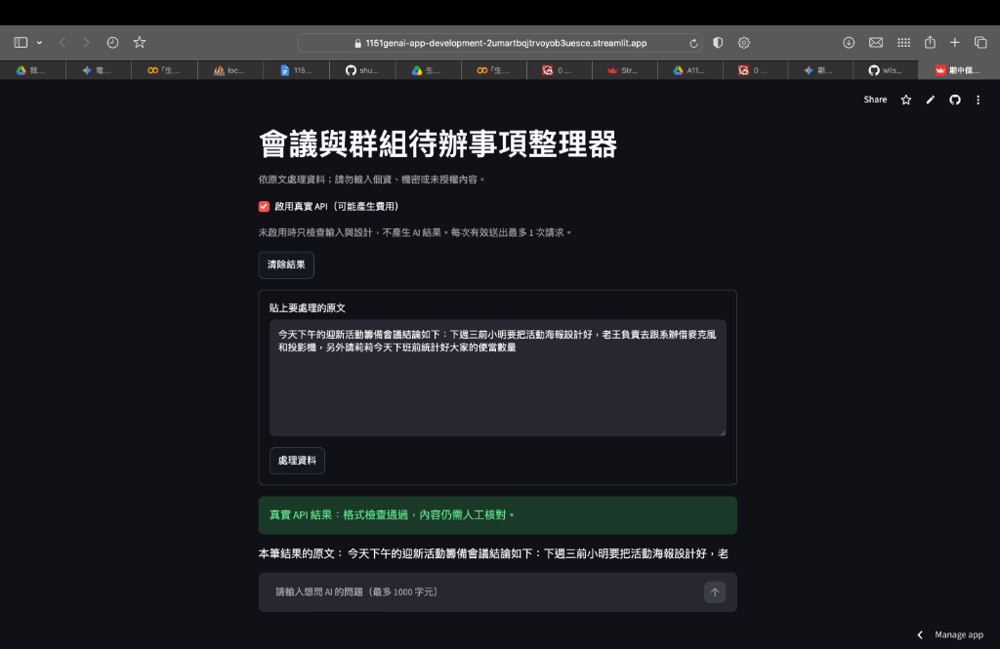
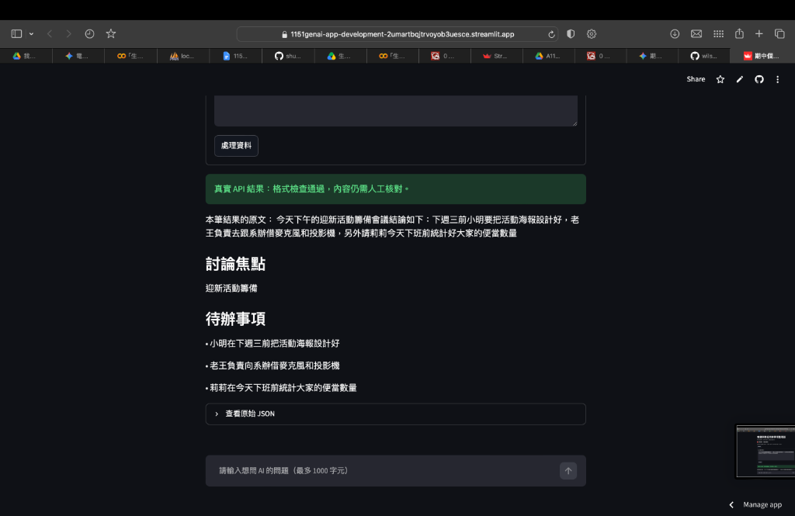
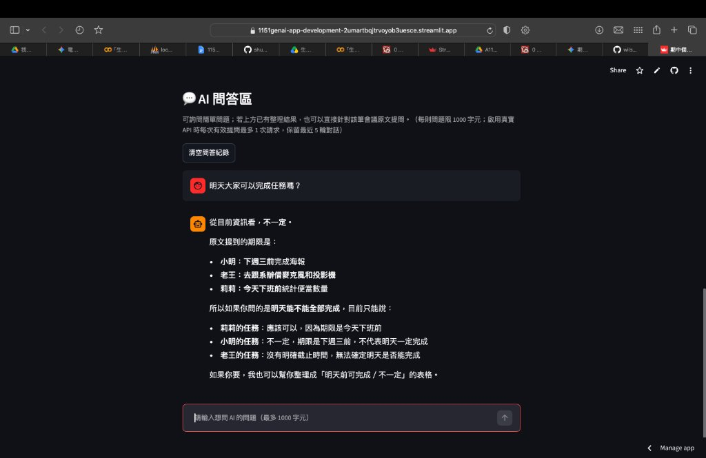

# 第 8 週｜個人專題設計與驗收紀錄

請複製後自行填寫。這是紀錄表，空白不代表通過；不可填入真實金鑰或個資。

## 一、自己的問題與設計

| 項目                    | 我的內容                                                                                                                                                                  |
| ----------------------- | ------------------------------------------------------------------------------------------------------------------------------------------------------------------------- |
| App 名稱／作者          | 會議與群組待辦事項整理器／李承威                                                                                                                                          |
| 目標使用者與情境        | 需要快速整理會議紀錄或 LINE 群組討論的人。將群組對話貼上，快速查看會議焦點與待辦事項。                                                                                    |
| 想完成的一個任務        | 將一段討論文字整理為會議焦點與具體待辦事項清單。                                                                                                                          |
| 輸入資料與範圍          | 透過文字框貼上討論原文，按「處理資料」才提交；不可全空白，最多 6000 字元。                                                                                                |
| 資訊不足如何處理        | 任務規則要求只依原文提取，明確說明不足，不自行編造。原文沒有待辦時回傳空清單                                                                                              |
| 採用 starter 或自行實作 | 採用 Pydantic 版起步專案 , Pydantic 版的程式碼看起來會比較精簡、直觀                                                                                                      |
| 結構化輸出路線          | Pydantic，Pydantic 版的程式碼看起來會比較精簡、直觀                                                                                                                       |
| 相較教師範例的個人設計  | 修改了 App 標題、任務規則 (Prompt)，將欄位設計為 `meeting_topic` 與 `action_items` 兩欄，並額外新增「💬 AI 問答區」延伸功能（可詢問簡單問題或針對當筆會議原文追問細節）。 |

## 二、輸出欄位契約

至少兩個有用途的欄位；可自行加列。

meeting_topic string；必填、非空白 呈現會議或討論的主要焦點 討論焦點 檢查是否符合原文討論的主題。

action_items array of string；必填；可為空清單 條列出誰要做什麼事 待辦事項 每一項都要在原文找得到，不能混入自己編造的任務。

## 三、測試紀錄

空白 API關閉，不輸入文字直接送出 顯示「請先輸入要處理的原文。」 提示清楚，擋下無效送出 離線操作
過長 API關閉，貼上超過 6000 字的文字 顯示「請縮短到 6000 字元以內...」 提示清楚，沒有偷偷截斷 離線操作
正常資料 開啟API，輸入：「今天對焦會議決定，下週三前小明要把前端介面切好，老王負責串接資料庫。」 畫面顯示焦點與兩項待辦事項（小明前端、老王資料庫） 有抓到具體任務，沒有無中生有 雲端真實API（這裡先填本機實測，等部署後再補上雲端日期）
資訊不足 開啟API，輸入：「今天天氣真好，想去釣魚。」 畫面顯示資訊不足，待辦事項顯示「原文沒有對應項目」 沒亂編造待辦，空清單合法 雲端真實API

真實 API 每筆補：測試日期、模型、完整虛構原文、實際 JSON／畫面結果、人工核對與實際請求數。
同一情境的修正前後用同一筆資料比較；不預設改 prompt 必然改善。不要用固定假回應填「真實 API」。
未測項目寫未測；請求失敗如實記錄，不捏造成功紀錄。真人瀏覽器／部署與程式模擬分開標示。
正常／資訊不足兩筆可直接在雲端完成，不必本機再重複呼叫；至少一筆須為雲端真實API成功。若追加測試，須另計請求數。

圖片：

1. **雲端真實 API 輸入畫面**
   

2. **雲端真實 API 結構化輸出結果（討論焦點與待辦事項）**
   

3. **延伸功能「💬 AI 問答區」雲端追問測試**
   

## 四、環境、交付與反思

Python／Streamlit／OpenAI SDK／python-dotenv 實際版本：待填。採 Pydantic 者另填其實際版本。
GitHub：待填。
啟動方式：切換到 `Midterm Mini-Project` 資料夾後執行 `python -m streamlit run app.py`。
Streamlit Community Cloud部署網址（必填）：https://1151genai-app-development-2umartbqjtrvoyob3uesce.streamlit.app
部署Repo／分支／入口、Cloud實際Python版本、驗收日期與結果：2026-11-09 部署成功，並已在雲端測試 API 呼叫通過。
老師觀看權限確認：待填。
部署為必做；未部署或未通過者如實記錄錯誤與待補驗項目，依老師公告期限完成，不以本機截圖代替。
本次實際請求數／追加測試數：正常 1 次，資訊不足 1 次，共 2 次。尚未完成的驗證：待填。
AI 協助內容：使用 Gemini 協助發想專題題目，並在雲端部署失敗時協助排除 `requirements.txt` 路徑空格導致的當機錯誤。

- **最有用的欄位**：`action_items` 將長篇大論直接拆解成具體任務清單，對會議情境非常有幫助。
  自己的修改與親自驗證：Streamlit Cloud 部署時，因為資料夾名稱 `Midterm Mini-Project` 包含空格，導致讀取內層套件清單時發生系統指令錯誤 (`Invalid requirement`)。修正方式為將 `pydantic` 等套件統一寫在 Repo 根目錄的 `requirements.txt`，並刪除內層清單，即可成功部署。。
  最有用的欄位、遇到的錯誤、已知限制與下一步：`action_items`（待辦事項）清單讓群組過濾廢話 。
  在部署到 Streamlit Cloud 時，因為老師規定的資料夾名稱 `Midterm Mini-Project` 包含空格，導致雲端系統執行安裝指令時路徑斷掉，跳出 `Invalid requirement` 的當機錯誤。
  目前只支援純文字貼上，若會議紀錄是圖文並茂或檔案格式就無法處理。
  希望能擴充「檔案上傳」功能
